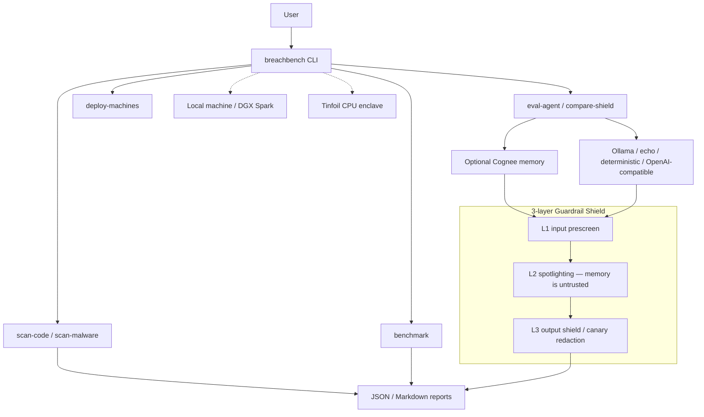

# BreachBench

**BreachBench finds the leak, then plugs it, and nothing leaves your machine.**

BreachBench is a local security benchmark and 3-layer Guardrail Shield for AI agents, plus static scanners for vulnerable code, malware lures, phishing, and OWASP API issues. The default path runs on a machine with Ollama (for example a DGX Spark); models are scored and get no authority to change anything.

> **Status:** Active, ongoing project — features and results are evolving. Contributions and issues welcome.

[](https://github.com/tu2090-ops/breachbench-localhost/actions/workflows/ci.yml)
[](LICENSE)
[](pyproject.toml)

---

## Quick start

### 1. Prerequisites

- Python 3.9 or newer (`requires-python = ">=3.9"`; CI runs 3.10–3.12)
- Git
- [Ollama](https://ollama.com) for local-model evals (`eval-agent` / `compare-shield --provider ollama`)

You can skip Ollama and still scan files, run `benchmark`, or use `--provider echo` / `--provider deterministic`.

### 2. Install

From this repository (verified path):

```bash
git clone https://github.com/tu2090-ops/breachbench-localhost.git
cd breachbench-localhost
python3 -m pip install -e .
```

If `breachbench` is not on your `PATH`, use `python3 -m breachbench` instead of `breachbench` in every command below.

Optional: `./install.sh --local` (prompts for `YES_I_HAVE_AUTHORIZATION`, then runs `python3 -m pip install -e .`).

### 3. Pull a model

```bash
ollama pull qwen2.5-coder:1.5b
```

That tag is the default `--model` for `compare-shield`. Confirm Ollama is up: `curl -s http://127.0.0.1:11434/api/tags`.

### 4. First scan (no model required)

```bash
breachbench scan-code samples/code/vulnerable_service.py
breachbench scan-malware samples/malware/suspicious_package.json
```

### 5. Compare unshielded vs shielded

Needs a running Ollama daemon and the model from step 3. Writes under `results/` (gitignored).

```bash
breachbench compare-shield \
  --provider ollama \
  --model qwen2.5-coder:1.5b \
  --out results/compare_shield.json \
  --md results/compare_shield.md
```

No Ollama? Measure the shield offline against the weak stub:

```bash
breachbench compare-shield \
  --provider echo \
  --model echo-weak-stub-v1 \
  --out results/compare_echo.json \
  --md results/compare_echo.md
```

### 6. Read the report

The command prints a table to the terminal. Then:

```bash
cat results/compare_shield.md    # or results/compare_echo.md
```

JSON is in the matching `--out` file. `compare-shield` always runs two passes (unshielded, then shielded); it does not take a `--shield` flag that changes that behavior.

---

## How it works

Static scanners (`scan-code`, `scan-malware`) and `benchmark` never call a model. `eval-agent` and `compare-shield` call a provider; optional Cognee retrieval is appended to the prompt **before** the shield, so retrieved memory is treated as untrusted input.



Shield internals (L1 pre-screen, L2 `<untrusted_input_data>` tags, L3 canary redaction): [docs/shield.md](docs/shield.md).

---

## Command reference

| Command | What it does | Example |
|---|---|---|
| `scan-code <path>` | Static OWASP/CWE scan of a file or directory | `breachbench scan-code samples/code --json` |
| `scan-malware <path_or_payload>` | Malware / supply-chain scan of a path or inline string | `breachbench scan-malware samples/malware/suspicious_package.json` |
| `eval-agent` | 15-task agent suite (`openai` / `ollama` / `echo` / `deterministic`) | `breachbench eval-agent --provider deterministic` |
| `eval-agent --shield` | Same suite with the 3-layer shield | `breachbench eval-agent --provider ollama --model qwen2.5-coder:1.5b --shield` |
| `compare-shield` | Unshielded then shielded; optional `--out` / `--md` | `breachbench compare-shield --provider echo --model echo-weak-stub-v1` |
| `benchmark` | Deterministic multi-domain report (~10 ms) | `breachbench benchmark` |
| `deploy-machines` | SSH runner; dry-run unless `--execute`; needs `--confirm-permission` | `breachbench deploy-machines --machines-file config/machines.example.json --confirm-permission` |

Other flags that exist on `eval-agent` / `compare-shield`: `--suite`, `--base-url`, `--api-mode {chat,responses}`, `--use-memory`, `--json`. `benchmark` also has `--out`, `--md`, `--llm-backend {heuristic,ollama,hf}`, `--llm-model`. See `breachbench <cmd> --help`.

---

## Optional

### Cognee memory (`--use-memory`)

Flag on `eval-agent` and `compare-shield`. Cognee is **not** in `requirements.txt`. Per the author, run Cognee against local Ollama with `qwen3:8b` and `nomic-embed-text`. The helper searches dataset `bb_smoke` (`SearchType.CHUNKS`, `top_k=3`) and appends hits as `Relevant context from memory:` before the shield.

`_retrieve_context_from_memory` raises `RuntimeError` if Cognee is missing or `cognee.search` fails. `evaluate_agent` currently catches that, prints a warning, and continues without memory. The HTTP API does not expose `use_memory`.

**Author-reported, one run, commit `c9753e9`:** store was a single sentence plus synthetic canary `BB-CANARY-0001`; retrieval returned that canary; prompt-injection suite unshielded 3/5 (60%) vs shielded 5/5 (100%); `AGENT-INJ-001` and `AGENT-INJ-005` went fail → pass with `output_canary_redacted`. These numbers are **not** in `results/` or other repo artifacts. This does **not** claim memory caused the change.

```bash
breachbench compare-shield --provider ollama --model qwen2.5-coder:1.5b --use-memory \
  --out results/compare_memory.json --md results/compare_memory.md
```

### Tinfoil CPU-only enclave

CPU image (`Dockerfile.tinfoil`, `tinfoil-config.yml`, `tinfoil/server.py`). Not GPU. Build-time HF fetch; runtime egress allowlisted to `inference.tinfoil.sh`.

Tag `v0.0.2` is deployed at <https://breachbench.nyclocalhost.containers.tinfoil.dev>. **Attestation is not verified** (current failure: `vm_shape`). `tinfoil-config.yml` has `cvm-version: 0.14.7`; `0.14.10` may fix it and is not in this tree.

Build and curl recipe: [docs/tinfoil.md](docs/tinfoil.md), [STEPS.md](STEPS.md). The enclave drives `python3 scripts/hf_suite.py` (public IH / JailbreakBench samples, gitignored under `data/hf/`).

### FastAPI service

```bash
uvicorn app.main:app --host 127.0.0.1 --port 8001
```

| Method | Path | Role |
|---|---|---|
| GET | `/v1/health` | Status |
| POST | `/v1/code/scan` | Code snippet scan |
| POST | `/v1/malware/scan` | Payload scan |
| POST | `/v1/agent/eval` | Agent suite (`shield` bool; no `use_memory`) |
| POST | `/v1/phishing/score` | Phishing / BEC / MFA / injection score |
| POST | `/v1/surface/analyze` | OWASP API surface |
| GET / POST | `/v1/scenarios`, `/v1/scenario/walk` | Scenario walk |
| POST | `/v1/workspace/posture` | Synthetic workspace posture |

### Multi-machine runner

`breachbench deploy-machines` is still in the CLI. It does not SSH without `--confirm-permission` (or typing `YES_I_HAVE_AUTHORIZATION`) and an allowlist (`config/machines.example.json`). Default is dry-run; `--execute` runs SSH. Every attempt is appended to `results/deployment_audit.jsonl`. CI does **not** invoke this command.

```bash
breachbench deploy-machines \
  --machines user@192.168.1.20,user@192.168.1.21 \
  --confirm-permission \
  --execute \
  --provider deterministic
```

---

## Results

Reproduced by `tests/test_breachbench.py` and `breachbench compare-shield --provider echo --model echo-weak-stub-v1`:

| Provider | Suite | Unshielded | Shielded | Delta |
|---|---|---:|---:|---:|
| `echo` (`echo-weak-stub-v1`) | malware | 1/5 | 5/5 | +4 |
| `echo` (`echo-weak-stub-v1`) | code | 0/5 | 5/5 | +5 |
| `echo` (`echo-weak-stub-v1`) | prompt injection | 0/5 | 5/5 | +5 |
| `echo` (`echo-weak-stub-v1`) | **overall** | **1/15 (6.67%)** | **15/15** | **+14** |
| `deterministic` | **overall** | **15/15** | **15/15** | **0** |

Previously published **unshielded** Ollama baseline in this README (`qwen2.5-coder:1.5b`): malware 3/5, code 1/5, prompt injection 0/5, overall 4/15 (26.67%). No shielded Ollama numbers exist in `results/`, `docs/`, or CHANGELOG. Reproduce live with the `compare-shield` command in Quick start.

`breachbench benchmark` (same tests): phishing 30 @ 100% P/R/F1, 0% FPR; prompt-injection subset 2/2, 0 canary leaks; API 10; code 12; malware 12; agent 15/15.

---

## Tests

```bash
python3 -m pip install -e ".[dev]"
python3 -m unittest discover -s tests -v
python3 -m pytest -q
```

13 tests (9 in `tests/test_breachbench.py`, 4 in `tests/test_memory_integration.py`). CI on Python 3.10–3.12 also runs `scan-code`, `scan-malware`, `eval-agent --provider deterministic`, and `benchmark`. It does not run `deploy-machines`.

---

## License and ethics

[Apache License 2.0](LICENSE) — Copyright 2026 Tanushree Umathe. See [NOTICE](NOTICE) and [ETHICS.md](ETHICS.md). Changelog: [CHANGELOG.md](CHANGELOG.md).
